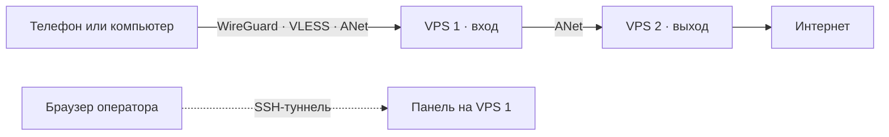

# ANet Easy

**Свой VPN на двух VPS.** Телефон или компьютер подключается к входному серверу по WireGuard, VLESS/TLS или ANet. Вход передаёт трафик на второй сервер по ANet, и сайты видят IP-адрес выхода. Мастер настраивает оба узла по SSH и выдаёт готовые клиентские профили.

[Установка по шагам](contrib/deploy/distribution/START-HERE.md) · [VLESS и HTTPS](contrib/deploy/distribution/START-HERE.md#vless-с-сайтом-и-бесплатным-сертификатом) · [Документация оператора](contrib/deploy/README.md)



## Быстрый старт

Подготовьте две VPS на **Debian или Ubuntu, amd64**, с systemd и доступом к `/dev/net/tun`. Для каждой понадобятся адрес, SSH-порт и пользователь с правами root или sudo. Для первого подключения по WireGuard достаточно IP-адресов.

### 1. На своём компьютере откройте каталог поставки

Для установки из готовых образов получите у владельца поставки комплект ANet Easy. В каталоге должны лежать `install.sh`, `images.tar`, `manifest.json`, `source.tar.gz` и помощники передачи. **Архив образов поставляется отдельно от исходников Git.**

| Ваш терминал | Команда из каталога поставки |
| --- | --- |
| Windows PowerShell | `.\send-to-vps.ps1` |
| Linux, macOS или WSL | `bash ./send-to-vps.sh` |

Введите SSH-адрес, порт и логин **первой VPS**. Помощник скопирует четыре файла и откроет мастер на сервере в этом же окне.

### 2. В мастере выберите маршрут

Для первого подключения выберите **Установить → Рекомендуемые настройки**. Укажите один вход и один выход. Назначьте текущую VPS входом, введите SSH-реквизиты второй и выберите один профиль WireGuard. Перед подтверждением мастер покажет адреса и порты. Откройте указанные порты в firewall обеих VPS.

Для **VLESS** направьте домен на входную VPS и выберите **Let’s Encrypt**. Мастер выпустит сертификат, поднимет HTTPS-сайт на nginx и проверит TLS на порту профиля. Для страницы можно выбрать «Студия», «Журнал» или публичный профиль GitHub. Сайт использует TCP 443, VLESS — отдельный порт из плана. [Настройка DNS, портов и сертификата](contrib/deploy/distribution/START-HERE.md#vless-с-сайтом-и-бесплатным-сертификатом)

### 3. Скачайте профиль и подключитесь

В конце установки мастер напечатает две команды. **На VPS** выполните команду чтения пароля администратора. **На своём компьютере** откройте второе окно терминала и выполните команду SSH-туннеля. Оставьте это окно открытым.

Откройте в браузере адрес из мастера (по умолчанию `http://127.0.0.1:8088`), войдите как `admin` и выберите **Профили и маршруты → Профили мастера установки → Скачать профиль**.

| Протокол | Что импортировать |
| --- | --- |
| WireGuard | Файл `.conf` в приложении WireGuard |
| VLESS/TLS | Ссылку из файла `.uri` в клиенте с поддержкой VLESS/TLS |
| ANet | Файл конфигурации `.toml` в клиенте ANet |

После подключения проверьте внешний IPv4 клиента. Для маршрута на схеме он должен совпасть с публичным адресом **VPS 2**.

## Работа с исходниками

```sh
git clone https://github.com/AlphaO612/easy_anet.git
cd easy_anet
```

| Задача | Руководство |
| --- | --- |
| Передать комплект вручную, продолжить после обрыва SSH | [Команды и разбор ошибок](contrib/deploy/distribution/START-HERE.md) |
| Подготовить комплект или разместить HTTPS-установщик | [Доставка ANet Easy](contrib/deploy/distribution/README.md) |
| Управлять входами, выходами и назначениями пользователей | [Управляемые профили](contrib/deploy/docs/managed-flow.ru.md) |
| Разобраться в протоколе и клиентах | [Описание ANet](contrib/docs/anet.ru.md) · [Исходный проект ZeroTworu/anet](https://github.com/ZeroTworu/anet) |
