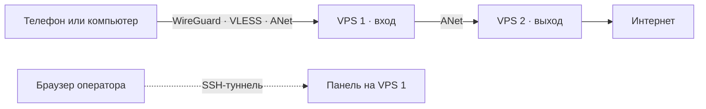

<h1 align="center">ANet Easy</h1>

<p align="center"><strong>Свой VPN на двух VPS — от SSH-доступа до готового профиля.</strong></p>

<p align="center">
  <a href="https://github.com/AlphaO612/easy_anet/releases/latest"></a>
  
  <a href="LICENSE.md"></a>
</p>

<p align="center">
  <a href="https://github.com/AlphaO612/easy_anet/releases/latest/download/anet-easy-linux-amd64.zip"><strong>Скачать ZIP</strong></a> ·
  <a href="release/README.md">Состав релиза и SHA-256</a> ·
  <a href="contrib/deploy/distribution/START-HERE.md">Инструкция по шагам</a>
</p>

Телефон или компьютер подключается к первой VPS по **WireGuard, VLESS/TLS или ANet**. Вторая VPS служит выходом в интернет. Мастер настраивает оба узла по SSH, а из панели можно скачать клиентский профиль и посмотреть, какой выход ему назначен.

## Быстрый старт

**На своём компьютере** выполните блок для вашей ОС. Он скачает готовый ZIP из **GitHub Releases**, распакует его во временный каталог и запустит помощник передачи. Образы уже включены.

**Для серверов** подготовьте две VPS на Debian или Ubuntu **amd64** с systemd и `/dev/net/tun`. Понадобятся адреса, SSH-порты и доступ через root или sudo. Для WireGuard достаточно IP-адресов.

### Windows · PowerShell

```powershell
$dir = Join-Path $env:TEMP ("anet-" + [guid]::NewGuid())
$null = New-Item -ItemType Directory -Path $dir -ErrorAction Stop
$zip = Join-Path $dir "anet-easy.zip"
$release = "https://github.com/AlphaO612/easy_anet/releases/latest/download"
curl.exe -fL --retry 2 -o $zip "$release/anet-easy-linux-amd64.zip"
if ($LASTEXITCODE -ne 0) { throw "Не удалось скачать релиз. Повторите команду." }
$sum = curl.exe -fsSL --retry 2 "$release/SHA256SUMS"
if ($LASTEXITCODE -ne 0 -or (Get-FileHash $zip).Hash -ne ($sum -split '\s+')[0]) { throw "Ошибка проверки SHA-256." }
Expand-Archive -LiteralPath $zip -DestinationPath $dir -ErrorAction Stop
$helper = "$dir\anet-easy\send-to-vps.ps1"
Unblock-File -LiteralPath $helper
powershell.exe -NoProfile -ExecutionPolicy RemoteSigned -File $helper
```

### Linux и macOS · Терминал

```sh
dir=$(mktemp -d) &&
curl -fL --retry 2 -o "$dir/anet-easy.zip" https://github.com/AlphaO612/easy_anet/releases/latest/download/anet-easy-linux-amd64.zip &&
unzip -q "$dir/anet-easy.zip" -d "$dir" &&
bash "$dir/anet-easy/send-to-vps.sh"
```

Помощник спросит **адрес, логин и SSH-порт первой VPS**, передаст четыре файла и откроет мастер в этом же окне. Если PowerShell ограничивает запуск скриптов, комплект уже распакован в `$dir\anet-easy`. [Передача вручную через SSH и SCP](contrib/deploy/distribution/START-HERE.md#2-если-хотите-передать-файлы-вручную)

## Что выбрать в мастере

1. **Маршрут.** Выберите **Установить → Рекомендуемые настройки**, один вход и один выход. Назначьте первую VPS входом и укажите SSH-реквизиты второй.
2. **Протокол.** Для первого подключения выберите один профиль WireGuard. Для VLESS с HTTPS укажите домен входа, выберите Let’s Encrypt и шаблон сайта. Перед подтверждением сверьте порты в плане с правилами firewall.
3. **Профиль.** После установки мастер напечатает команду чтения пароля на VPS и команду SSH-туннеля для компьютера. Откройте туннель, войдите в панель как `admin` и выберите **Профили и маршруты → Скачать профиль**.

| Профиль | Как подключиться |
| --- | --- |
| **WireGuard** | Импортируйте `.conf` через «Добавить туннель» в WireGuard |
| **VLESS/TLS** | Скопируйте ссылку из `.uri` в клиент VLESS/TLS |
| **ANet** | Откройте конфигурацию `.toml` в клиенте ANet |

## Как проходит трафик



После подключения проверьте внешний IPv4 клиента. Для маршрута на схеме сайты должны видеть публичный адрес **VPS 2**.

## Документация

- [Установка, этапы и восстановление после обрыва SSH](contrib/deploy/distribution/START-HERE.md)
- [VLESS с доменом, сайтом nginx и сертификатом Let’s Encrypt](contrib/deploy/distribution/START-HERE.md#vless-с-сайтом-и-бесплатным-сертификатом)
- [Управление входами, выходами и профилями](contrib/deploy/docs/managed-flow.ru.md)
- [Подготовка собственного комплекта](contrib/deploy/distribution/README.md)
- [Протокол ANet](contrib/docs/anet.ru.md) · [Исходный проект ZeroTworu/anet](https://github.com/ZeroTworu/anet)

<details>
<summary>Клонировать исходники для разработки</summary>

```sh
git clone https://github.com/AlphaO612/easy_anet.git
cd easy_anet
```

</details>
